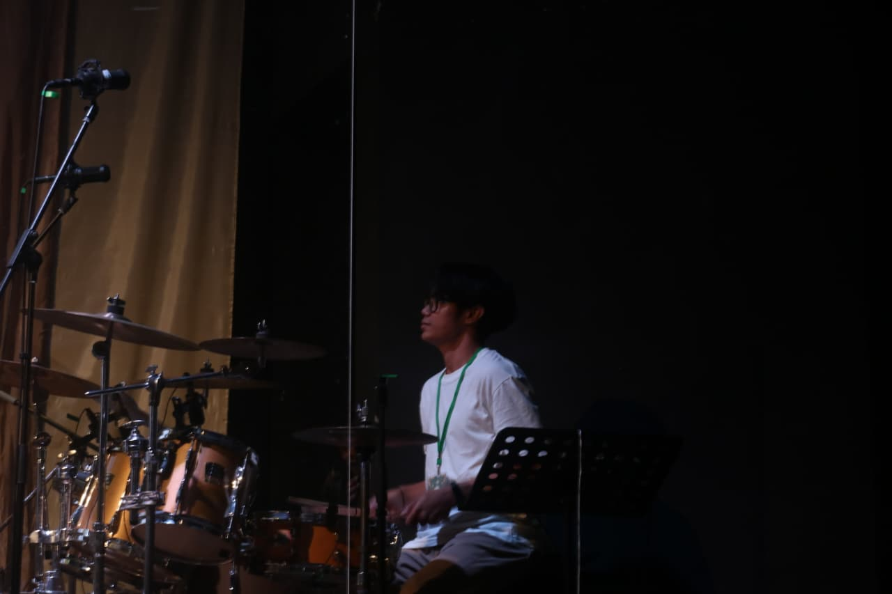
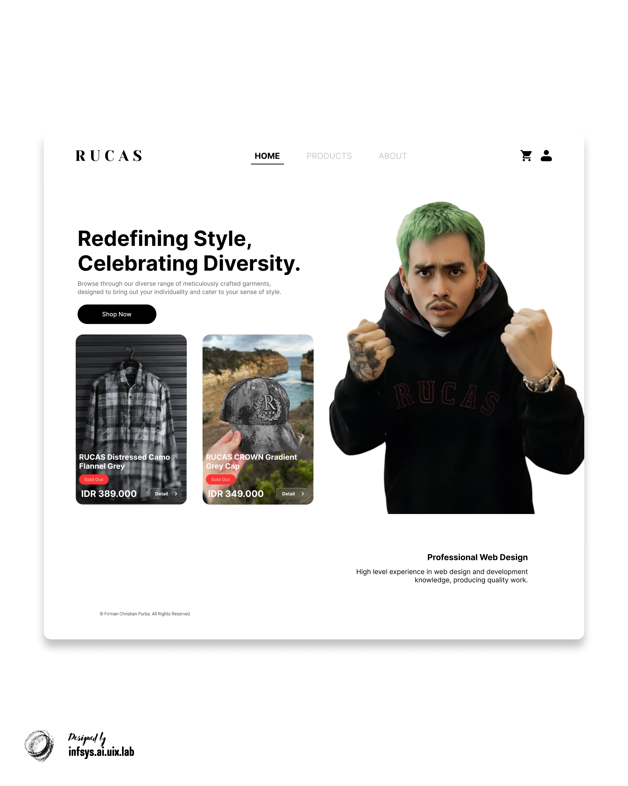
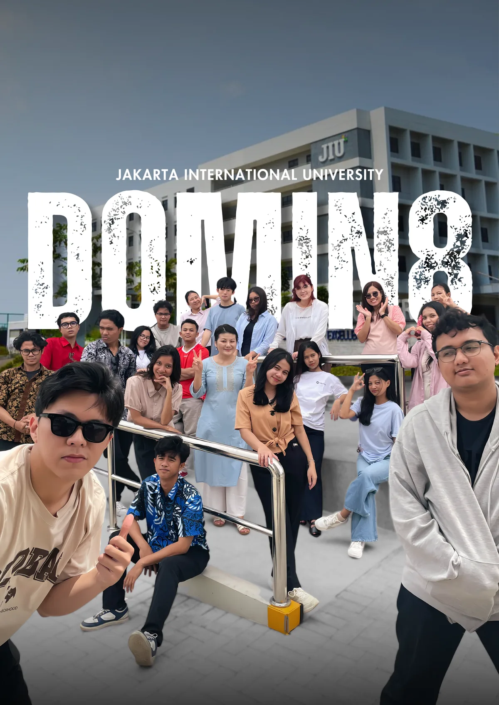

<div align="center">



# Firman Christian Purba

**UI/UX Designer · Front-End Engineer · Information Systems**

Bridging human-centered design with high-performance front-end engineering
to build scalable, accessible digital ecosystems.

[](https://firmanchrstn.github.io/my-portfolio/)
[](https://www.linkedin.com/in/firmanchristianpurba/)
[](mailto:firmanchristianp@gmail.com)


</div>

---

## Overview

This repository contains the source code for my professional portfolio (**v2.0**) — a
hand-built digital ecosystem that showcases my work across **Information Systems**,
**UI/UX Design**, and **Front-End Engineering**.

The site is intentionally **build-free**: every page is a plain, hand-maintained HTML
document, and the repository *is* the deployed artifact. There is no framework, no
bundler, and no runtime dependency to keep in sync. What you see in the source is
exactly what ships to production.

> **Design principle:** Systematic design, flawless code — performance, accessibility,
> and maintainability treated as first-class requirements rather than afterthoughts.

## Selected Work

| Preview | Project | Focus | Links |
| :---: | --- | --- | --- |
|  | **Mobile JKN Redesign** | UI/UX Design · AI Implementation | [Case Study](https://firmanchrstn.github.io/my-portfolio/mobile-jkn.html) · [Live Demo](https://firmanchrstn.github.io/demo-mobilejkn/) |
|  | **MIA 2025 ft. LinkAja** | UI/UX Design · Product Strategy | [Case Study](https://firmanchrstn.github.io/my-portfolio/linkaja-competition.html) |
|  | **inDrive Redesign** | UI/UX Design · Product Design | [Case Study](https://firmanchrstn.github.io/my-portfolio/inDrive.html) |
|  | **Rucas.co Digital Store** | Web Design · E-Commerce | [Case Study](https://firmanchrstn.github.io/my-portfolio/rucas.html) |
|  | **Wisata App** | Flutter · Mobile Development | [Case Study](https://firmanchrstn.github.io/my-portfolio/wisata-app-flutter.html) |
|  | **DOMIN8 Identity** | Graphic Design · Branding | [Case Study](https://firmanchrstn.github.io/my-portfolio/poster1.html) |

The portfolio also includes front-end showcases for
[Terre Bistro & Bar](https://firmanchrstn.github.io/my-portfolio/terebistrobar.html) and
[Puri Resto & Cafe](https://firmanchrstn.github.io/my-portfolio/purirestocafe.html),
plus additional graphic design campaigns in
[Poster 02](https://firmanchrstn.github.io/my-portfolio/poster2.html) and
[Poster 03](https://firmanchrstn.github.io/my-portfolio/poster3.html).

## Technical Architecture

The website is custom-built from the ground up without heavy JavaScript frameworks,
demonstrating a deep understanding of native web capabilities and Core Web Vitals
optimization.

### Markup — HTML5

- Strict semantic HTML for superior SEO and accessibility.
- Native HTML5 `<dialog>` API for accessible, focus-trapped modals.
- `<template>` tags for efficient, zero-duplication DOM rendering.

### Styling — CSS3

- Fluid typography and layouts using `clamp()`, `min()`, and `max()`.
- Modern CSS Grid (auto-fit / Bento Grid patterns) and Flexbox architecture.
- Comprehensive CSS Custom Properties (design tokens) for theming and dark mode.

### Scripting — Vanilla JavaScript

- Modular IIFE (Immediately Invoked Function Expression) architecture.
- High-performance `IntersectionObserver` for scroll-spy and scroll-reveal animations.
- Strict event delegation to minimize the memory footprint.

### Delivery

- Static hosting on **GitHub Pages**, deployed by **GitHub Actions**.
- Zero runtime dependencies; Node.js is used only for the integrity checker.

## Engineering Highlights

- **Core Web Vitals optimized** — explicit `width`/`height` and `loading="lazy"` on media
  to prevent Cumulative Layout Shift (CLS) and improve Largest Contentful Paint (LCP).
- **Accessibility-first (A11y)** — `prefers-reduced-motion` support, visible keyboard
  focus states, proper ARIA labeling, and native browser focus trapping.
- **Progressive disclosure** — case studies use a modal/lightbox architecture to deliver
  deep project context without forcing page reloads.
- **Reference-counted scroll lock** — nested modals (lightbox opened from a study modal)
  dismiss without unlocking the page underneath.
- **Technical SEO** — structured `<head>` metadata, Open Graph integration, canonical
  URLs, JSON-LD, a generated sitemap, and semantic landmarks.
- **Integrity tooling** — a zero-dependency verifier gates every deploy against broken
  links, duplicate IDs, encoding drift, and shell inconsistencies.

## Project Structure

The project is organized with a clear separation of concerns to support long-term
scalability.

**Pages** — each is a standalone, independently deployable document:

| File | Purpose |
| --- | --- |
| `index.html` | Primary landing page and global entry point. |
| `mobile-jkn.html` | UI/UX and AI implementation case study for the Mobile JKN redesign. |
| `linkaja-competition.html` | UX strategy case study for MIA 2025 ft. LinkAja. |
| `inDrive.html` | Product/UX case study for the inDrive rider app. |
| `rucas.html` | Web design and e-commerce concept for Rucas.co. |
| `terebistrobar.html`, `purirestocafe.html` | Front-end engineering showcases. |
| `wisata-app-flutter.html` | Flutter travel app case study. |
| `poster1.html` – `poster3.html` | Graphic design and creative campaign galleries. |
| `404.html` | Not-found page. Excluded from the sitemap and the shared-shell check. |

**Shared code, tooling, and site files:**

| Path | Purpose |
| --- | --- |
| `css/style.css` | Global design tokens, layout system, and utilities. |
| `css/portfolio.css` | Project-specific components and case study styling. |
| `css/case-study.css` | Shared case-study styling: tabs, intros, summary grid, prototype CTAs, gallery cards, modals, and the lightbox. |
| `js/script.js` | Theme, navigation, scroll-spy, tabs, and shared dialog state. |
| `asset/` | Centralized storage for project assets, documentation (PDFs), and optimized media. |
| `tools/verify.js` | Zero-dependency integrity checks. |
| `favicon.svg`, `robots.txt`, `sitemap.xml` | Standard site metadata. |
| `.github/workflows/deploy.yml` | Verification and GitHub Pages deployment. |

## Getting Started

### Prerequisites

- Any modern browser.
- [Node.js](https://nodejs.org/) **18+** — only for the integrity checker.

### Run locally

Open `index.html` directly, or serve the folder with any static server. Live Server is
preconfigured on port **5502** in `.vscode/settings.json`.

```bash
# Option 1: VS Code Live Server (recommended)
# Right-click index.html → "Open with Live Server"

# Option 2: any static server
npx serve .
```

Serving over HTTP rather than `file://` is recommended so asset and PDF links behave
exactly as they do in production.

### Verify

```bash
npm run verify
```

## Quality Gates

`verify` performs static integrity checks with no dependencies:

| Group | Checks |
| --- | --- |
| **Encoding** | Valid UTF-8, no BOM, no non-breaking spaces, no tabs, no trailing whitespace, no mixed line endings. |
| **Links** | Every local `href`/`src` resolves; every `#anchor` has a matching `id`. |
| **Identifiers** | No duplicate `id` within a page. |
| **Markup** | `lang`, `title`, description, canonical, a single `<h1>`, image `alt`, and `label[for]` targets. |
| **Shell** | The shared `<head>`, header/nav, and footer invariants are present on every page. |
| **Sitemap** | Every public page is listed; `lastmod` values are valid and not stale. |

`verify` is static analysis only. It cannot tell you that a click handler still behaves,
so the interaction paths below still need a human pass.

<details>
<summary><strong>Manual QA checklist</strong></summary>

Run through this before publishing a change to `script.js` or the shared shell. Serve
over Live Server rather than `file://` so asset and PDF links behave as they do in
production.

**Mobile menu (viewport ≤ 768px)**

- On load, `Tab` skips the closed off-canvas links (they must be `inert`) and reaches the
  theme toggle instead.
- Opening the menu moves focus to the first link, and `Tab` / `Shift+Tab` cycle within the
  menu only, never into the page behind the overlay.
- `Esc`, the close button, and a nav link each close it, returning focus to the toggle.
  Resizing to a wider viewport while it is open collapses it inline and releases the
  scroll lock.
- `Ctrl+F` finds every nav label. This is what the old non-breaking-space indentation
  silently broke on one page.

**Study modal and lightbox (any case-study page)**

- A `.open-detail` trigger opens the modal with the close button focused and the
  background unable to scroll; `Esc`, the ×, and a backdrop click all dismiss it.
- Open the lightbox from *inside* the study modal, then close only the lightbox: the page
  must stay scroll-locked. This is the reference-counted scroll lock, and the most likely
  thing to regress.
- Clicking an image, or focusing it and pressing `Enter` / `Space`, shows the full
  uncropped image in the lightbox.

**Tabs (`mobile-jkn.html`)**

- Only one panel is visible at a time, and the active tab carries `is-active`,
  `aria-selected="true"`, and `tabindex="0"` while the other is `tabindex="-1"`.
- `←` and `→` move between tabs, wrap around at both ends, and move focus with them.
- Switching to a panel reveals its scroll-reveal blocks rather than leaving them stuck at
  opacity 0.
- The tab module lives in `script.js` and no-ops on pages without a tablist, so adding a
  tablist to any other page works with no extra wiring.

**Any page**

- The theme toggle's `aria-label` tracks the active theme, and the choice survives reload
  without a flash of the wrong theme.
- Scroll-spy and anchor links on the landing page land correctly.
- The contact form is `novalidate` with `action="#"` by design: it has no backend and
  submits nowhere.
- From 320px to 1920px there is no horizontal scroll, and native modals fit.

</details>

## Deployment

This portfolio is deployed to **GitHub Pages** by **GitHub Actions**. There is no build
step — the checked-in HTML is what gets published — so `main` pushes are gated only by
verification, not by compilation.

The workflow runs `npm run verify` before publishing, so a broken link, a duplicated
`id`, or a page that drifts from the shared shell blocks the deploy instead of shipping.
It then stages only the publishable files (`*.html`, `css/`, `js/`, `asset/`,
`favicon.svg`, `robots.txt`, `sitemap.xml`) into `_site/`, so tooling and repository
metadata are never published.

## Contact

I am currently open to new opportunities, collaborations, or simply a chat about design,
technology, and systems. Feel free to reach out:

- **Email:** [firmanchristianp@gmail.com](mailto:firmanchristianp@gmail.com)
- **LinkedIn:** [in/firmanchristianpurba](https://www.linkedin.com/in/firmanchristianpurba/)
- **GitHub:** [@firmanchrstn](https://github.com/firmanchrstn)
- **Portfolio:** [firmanchrstn.github.io/my-portfolio](https://firmanchrstn.github.io/my-portfolio/)

---

<div align="center">

**Systematic Design. Flawless Code.**

© 2026 Firman Christian Purba. All rights reserved.

</div>
